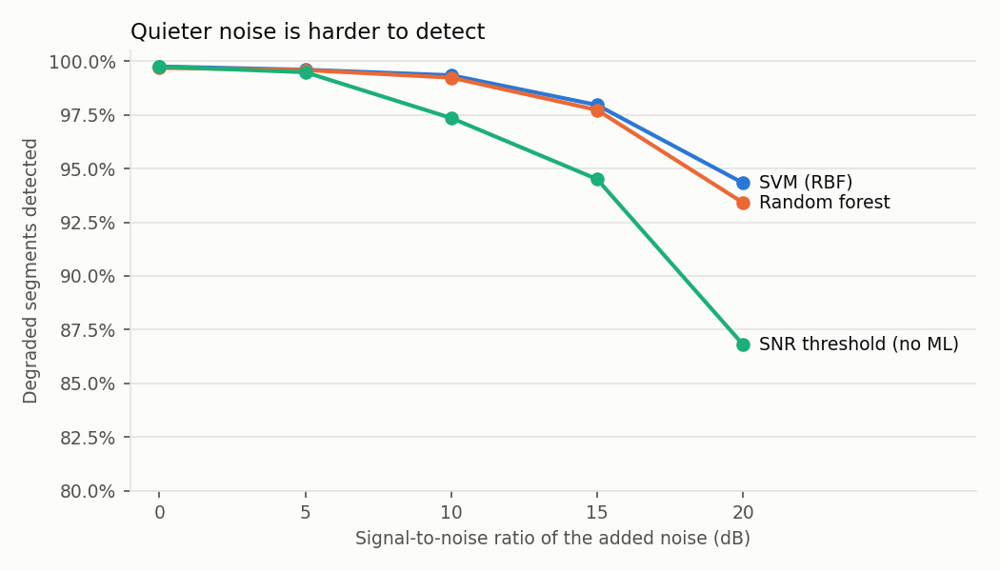
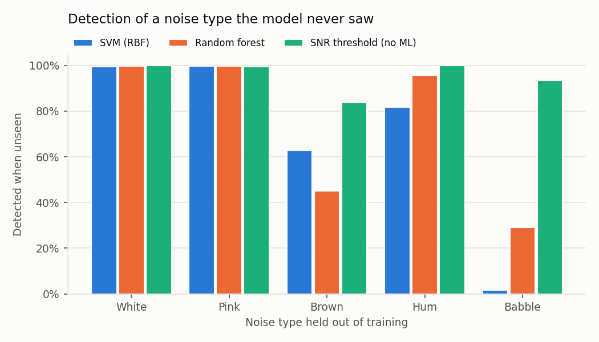

# Khmer Speech Data Quality

*Validation checks and a leakage-aware quality benchmark for Khmer speech-recognition (ASR) data.*


-lightgrey)

Khmer is a low-resource language for speech technology: open, well-documented recordings are scarce,
so every dataset that is collected must be checked before it is used to train a recogniser. This
project builds and tests the checking step:

1. **Corpus validation**: per-clip checks of audio integrity, levels, silence, signal-to-noise and
   Khmer transcripts, run on Google's open Khmer speech corpus (OpenSLR SLR42).
2. **A quality benchmark**: can a model tell clean recordings from degraded ones? It compares how the
   task is framed (speech vs non-speech, or clean vs noisy *speech*) and how it is evaluated (random
   split vs split by speaker), always against a simple non-ML baseline.
3. **A consent-first design** for a community recording platform ([docs/COLLECTION_DESIGN.md](docs/COLLECTION_DESIGN.md)).

It is an independent continuation of a 2024 ITC course project on Khmer ASR data collection
(credits in [docs/PROVENANCE.md](docs/PROVENANCE.md)); no material from that project is reused.

## Key findings

* **The corpus is clean and complete.** 2,906 recordings, 16 male speakers, 3.97 hours, all 48 kHz
  16-bit mono; every file is indexed, no duplicate audio, every transcript is 100% Khmer script.
  Median estimated SNR is 68 dB.
* **Two things the checks did find.** 335 clips (11.5%) contain more than 1.5 s of leading or
  trailing silence (up to 5.4 s; confirmed by inspecting energy curves), concentrated in two speakers
  (99 and 81 clips). 214 recordings share a sentence with another recording, which matters when
  splitting data for ASR training.
* **Classifying speech against non-speech noise is trivial.** All five models score accuracy 1.000,
  so a high score in that framing says nothing about recording quality.
* **Clean vs noisy speech is also easy on studio audio, but it shows where detection fails.**
  Grouped by speaker, the best model (SVM) reaches 0.985 accuracy; detection falls to about 93-94%
  for noise at 20 dB SNR and for babble and brown noise. A simple SNR threshold reaches 0.912 but
  wrongly flags 13% of clean clips, against 1-2% for the models.
* **The models fail on noise they were not trained on.** Holding one noise type out of training,
  the SVM detects only **1.7%** of recordings with unseen background speech (babble), while the
  simple SNR threshold detects 93.5%. High in-distribution accuracy is not evidence of a usable
  quality filter.
* **Leakage from a random split was small here** (accuracy 0.990 vs 0.985 when grouped by
  speaker), even though about 760 recordings had segments on both sides of the random split.

## Results

### Corpus validation ([reports/validation_summary.json](reports/validation_summary.json))

| Measure | Value |
|---|---|
| Recordings / speakers / hours | 2,906 / 16 / 3.97 |
| Format | 48 kHz, 16-bit, mono (all files) |
| Duration (median, 5th-95th percentile) | 4.5 s (3.2-7.8 s) |
| Estimated SNR (median, minimum) | 68 dB, 39 dB |
| Index problems, duplicate audio, non-Khmer transcripts | none |
| Clips with edge silence > 1.5 s | 335 |
| Speech-rate outliers (\|robust z\| > 4) | 5 (borderline, z 4.0-4.5) |
| Recordings sharing a sentence | 214 (2,799 distinct sentences) |

Flagged clips are listed (ids and measurements only) in [reports/flagged_clips.csv](reports/flagged_clips.csv).
Flags are screening rules: they mark clips to listen to, not to delete.

### Quality benchmark ([reports/benchmark.json](reports/benchmark.json))

5,678 two-second segments per task; mean over 3 seeds (standard deviation at most 0.006).

| Framing | Evaluation | SVM | Random forest | KNN (k=3) | Gradient boosting | Logistic regression | SNR threshold |
|---|---|---|---|---|---|---|---|
| Speech vs non-speech noise | Random split | 1.000 | 1.000 | 1.000 | 1.000 | 1.000 | 0.966 |
| Speech vs non-speech noise | Grouped by speaker | 1.000 | 1.000 | 1.000 | 1.000 | 1.000 | 0.963 |
| Clean vs noisy speech | Random split | 0.990 | 0.984 | 0.989 | 0.984 | 0.984 | 0.910 |
| **Clean vs noisy speech** | **Grouped by speaker** | **0.985** | 0.979 | 0.978 | 0.977 | 0.972 | 0.912 |

Accuracy; classes are balanced (50.3% degraded). ROC-AUC is 0.991-0.999 for all models on the noisy-speech task.

**Where detection fails** (speaker-grouped, share of degraded segments detected):

| Added noise SNR | 0 dB | 5 dB | 10 dB | 15 dB | 20 dB |
|---|---|---|---|---|---|
| SVM | 0.998 | 0.996 | 0.993 | 0.980 | 0.943 |
| Random forest | 0.997 | 0.996 | 0.992 | 0.977 | 0.934 |
| SNR threshold | 0.997 | 0.995 | 0.974 | 0.945 | 0.868 |

| Noise type | White | Pink | Hum | Brown | Babble | False alarms on clean |
|---|---|---|---|---|---|---|
| SVM | 1.000 | 1.000 | 0.999 | 0.967 | 0.945 | 1.1% |
| Random forest | 1.000 | 1.000 | 0.998 | 0.956 | 0.944 | 2.1% |
| SNR threshold | 1.000 | 0.994 | 1.000 | 0.847 | 0.942 | 13.2% |



### Generalisation to an unseen noise type

Real recordings contain noise that no training set anticipates. Each noise type in turn was held
out of training (the models learn from clean speech and the other four types) and the detectors
were tested on held-out speakers with that unseen type. Share of degraded segments detected, mean
over 3 seeds:

| Held-out noise | SVM | Random forest | KNN | Gradient boosting | Logistic regression | SNR threshold |
|---|---|---|---|---|---|---|
| White | 0.995 | 0.996 | 0.994 | 0.850 | 0.690 | 1.000 |
| Pink | 0.998 | 0.996 | 0.973 | 0.893 | 1.000 | 0.994 |
| Hum | 0.818 | 0.958 | 0.797 | 0.976 | 0.966 | 1.000 |
| Brown | 0.628 | 0.449 | 0.673 | 0.441 | 0.616 | 0.838 |
| **Babble (other speakers)** | **0.017** | 0.291 | 0.048 | 0.135 | 0.146 | **0.935** |
| False alarms on clean speech | 0.1-1.2% | 0.1-2.1% | 0.1-2.6% | 0.2-2.6% | 0.5-3.5% | 12.8-13.5% |



**The models that score 0.98 in-distribution do not generalise.** Trained without babble, the SVM
detects 1.7% of recordings with background speech, the most likely noise in community recordings;
the best model reaches 29%. The non-ML SNR threshold, which learns nothing about noise shapes,
detects 93.5% of them, at the cost of flagging about 13% of clean clips. A learned quality filter
trained on synthetic noise should therefore not be used on its own; in a collection pipeline, a
simple SNR screen plus human review is the safer first step.

## Method

| Step | Detail |
|---|---|
| Audio | Resampled to 16 kHz mono; split into non-overlapping 2-second segments |
| Features | 13 MFCCs (mean and standard deviation) plus spectral flatness and zero-crossing rate: 30 per segment, implemented in NumPy |
| Degradation | Whole recordings are assigned to clean or degraded (balanced within each speaker), so one recording never appears in both classes. Degraded: white, pink, brown, mains hum or babble from *other* speakers, mixed at 0, 5, 10, 15 or 20 dB SNR |
| Original-style framing | Degraded class is non-speech noise at the same level, mirroring a speech-vs-noise setup |
| Models | SVM (RBF), random forest (300 trees), KNN (k=3), gradient boosting, logistic regression; standardised features; fixed seeds |
| Baseline | Estimated-SNR threshold, tuned on the training data only |
| Evaluation | Random 80/20 split of segments, and 5-fold cross-validation grouped by speaker |

## Limitations

* **Studio-quality, male-only, read speech.** SLR42 was recorded for speech synthesis. Real
  community recordings (phones, rooms, spontaneous speech, women and children, dialects) are not
  represented, so these accuracies will not transfer to them.
* **Synthetic degradations.** Noise is generated (coloured noise, hum) or built from other speakers;
  real environmental noise, reverberation, codec artefacts and clipping are not covered.
* **Sixteen speakers** limit the speaker-grouped evaluation.
* Validation thresholds are screening rules chosen in advance, not tuned against human judgements.
* The collection platform is a design document, not built software.

## Reproduce

```bash
python -m venv .venv && .venv/Scripts/python -m pip install -r requirements.txt
# download km_kh_male.zip from https://www.openslr.org/42/ and extract it
export KHMER_ASR_DATA_DIR=/path/to/km_kh_male          # contains line_index.tsv and wavs/
python scripts/validate_corpus.py    # about 40 s  -> reports/validation_summary.json, flagged_clips.csv
python scripts/run_benchmark.py      # about 25 min on a laptop CPU -> reports/benchmark.json
python scripts/make_figures.py       # -> reports/figures/
python -m pytest
```

No audio library is needed: WAV reading uses SciPy and the MFCCs are implemented in NumPy.

## Project structure

```
src/khmer_speech_qc/   audio, features (MFCC), checks (validation), degrade (noise, SNR mixing),
                       corpus (SLR42 index), benchmark (datasets, models, evaluation)
scripts/               validate_corpus.py, run_benchmark.py, make_figures.py
tests/                 unit tests on synthetic signals + real-corpus checks (skipped without data)
docs/                  DATA_SOURCE.md, PROVENANCE.md, COLLECTION_DESIGN.md
reports/               validation and benchmark outputs (no audio, no transcripts)
```

## Data, licence and credits

* **Data:** OpenSLR SLR42 by Google LLC, licensed CC BY-SA 4.0. Not redistributed here. Cite:
  Sodimana et al., *A Step-by-Step Process for Building TTS Voices Using Open Source Data and
  Framework for Bangla, Javanese, Khmer, Nepali, Sinhala, and Sundanese*, SLTU 2018,
  https://doi.org/10.21437/SLTU.2018-14. Details in [docs/DATA_SOURCE.md](docs/DATA_SOURCE.md).
* **Code:** MIT ([LICENSE](LICENSE)).
* **Origin:** inspired by the 2024 ITC Data Ethics course project *Khmer ASR Data Collection* by
  Suon Senchey, Thy Chantha and Taing Thaitheang (supervisor: Touch Sopheak). See
  [docs/PROVENANCE.md](docs/PROVENANCE.md).
* **Author:** Thy Chantha ([GitHub](https://github.com/THYCHANTHA)), developed with AI assistance.
